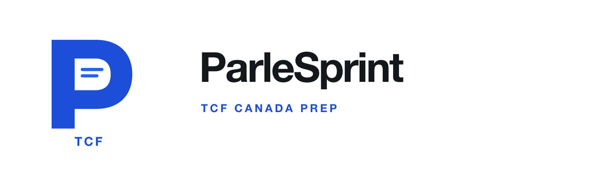

# ParleSprint TCF logo concepts

Ten independent blue-and-white logo directions for the v3 TCF Canada preparation app. Each concept has its own square app icon and horizontal ParleSprint lockup, both as SVG source and PNG renders.

## My shortlist

1. **05 — Counterform:** strongest icon silhouette and the clearest white/blue contrast.
2. **02 — Proofline:** the P and check connect directly to exam preparation.
3. **03 — Open Gate:** the quietest, most minimal direction.

## Palette

- Action blue: `#2563EB`
- Deep blue: `#1D4ED8`
- White: `#FFFFFF`
- Cool canvas: `#F5F6F8`
- Wordmark ink: `#14171C`

The app name remains **ParleSprint**. Each icon places `TCF` at the bottom; each horizontal lockup adds `TCF CANADA PREP` beneath the wordmark. The symbols are authored as fresh vector directions and use no gradients or external assets.

## Concepts

### 01 — Folio

A precise P with a small page fold cut into its lower stem.

- [Square app-icon SVG](01-folio/logo-icon.svg)
- [Square app-icon PNG](01-folio/logo-icon.png)
- [Horizontal logo SVG](01-folio/logo.svg)
- [Transparent horizontal logo PNG](01-folio/logo.png)

### 02 — Proofline

A clean P whose counter carries a quiet exam-check gesture.

- [Square app-icon SVG](02-proofline/logo-icon.svg)
- [Square app-icon PNG](02-proofline/logo-icon.png)
- [Horizontal logo SVG](02-proofline/logo.svg)
- [Transparent horizontal logo PNG](02-proofline/logo.png)

### 03 — Open Gate

An open, architectural P made from one confident continuous stroke.

- [Square app-icon SVG](03-open-gate/logo-icon.svg)
- [Square app-icon PNG](03-open-gate/logo-icon.png)
- [Horizontal logo SVG](03-open-gate/logo.svg)
- [Transparent horizontal logo PNG](03-open-gate/logo.png)

### 04 — Parle Ligature

The first and last initials share a single, restrained monogram.

- [Square app-icon SVG](04-parle-ligature/logo-icon.svg)
- [Square app-icon PNG](04-parle-ligature/logo-icon.png)
- [Horizontal logo SVG](04-parle-ligature/logo.svg)
- [Transparent horizontal logo PNG](04-parle-ligature/logo.png)

### 05 — Counterform

A white aperture holds a blue P, designed to read clearly at small sizes.

- [Square app-icon SVG](05-counterform/logo-icon.svg)
- [Square app-icon PNG](05-counterform/logo-icon.png)
- [Horizontal logo SVG](05-counterform/logo.svg)
- [Transparent horizontal logo PNG](05-counterform/logo.png)

### 06 — Focus Frame

A focused P surrounded by four light crop marks, with no extra ornament.

- [Square app-icon SVG](06-focus-frame/logo-icon.svg)
- [Square app-icon PNG](06-focus-frame/logo-icon.png)
- [Horizontal logo SVG](06-focus-frame/logo.svg)
- [Transparent horizontal logo PNG](06-focus-frame/logo.png)

### 07 — Phrase Window

Two short phrase lines sit inside the P counter like a small reading window.

- [Square app-icon SVG](07-phrase-window/logo-icon.svg)
- [Square app-icon PNG](07-phrase-window/logo-icon.png)
- [Horizontal logo SVG](07-phrase-window/logo.svg)
- [Transparent horizontal logo PNG](07-phrase-window/logo.png)

### 08 — Contour

A soft-cornered line mark gives the initial a quieter, more human feel.

- [Square app-icon SVG](08-contour/logo-icon.svg)
- [Square app-icon PNG](08-contour/logo-icon.png)
- [Horizontal logo SVG](08-contour/logo.svg)
- [Transparent horizontal logo PNG](08-contour/logo.png)

### 09 — Pace Cut

A forward-cut terminal gives the P motion without using a lightning bolt.

- [Square app-icon SVG](09-pace-cut/logo-icon.svg)
- [Square app-icon PNG](09-pace-cut/logo-icon.png)
- [Horizontal logo SVG](09-pace-cut/logo.svg)
- [Transparent horizontal logo PNG](09-pace-cut/logo.png)

### 10 — Folio Tab

A crisp document-tab detail makes the study purpose legible without a book cliché.

- [Square app-icon SVG](10-folio-tab/logo-icon.svg)
- [Square app-icon PNG](10-folio-tab/logo-icon.png)
- [Horizontal logo SVG](10-folio-tab/logo.svg)
- [Transparent horizontal logo PNG](10-folio-tab/logo.png)
